# Infrastructure Active Directory pour cinq promotions

Fanny Rivey, directrice des études, ouvre cinq nouvelles promotions (Volva, Heimdall, Zinc, Licorne et Basilic) et voulait repartir sur une infrastructure neuve. Il fallait un domaine Active Directory avec un compte et un groupe par promotion, et un dossier partagé par promotion que seuls ses membres peuvent ouvrir, à l'exception de Timothée, l'administrateur, qui doit pouvoir accéder à tous. Les fichiers `.divx` sont interdits, chaque promotion dispose de 30 Go, et les étudiants ont quelques règles imposées par GPO : le verrou numérique, un mot de passe à changer tous les 30 jours et un fond d'écran.

Tout tourne sur un Proxmox, derrière un pare-feu OPNsense qui sert de routeur au réseau.

---

## Les machines

J'ai créé deux VM, `SRV-DC-ethan` sous Windows Server 2025 pour le contrôleur de domaine et `CLI-W11-ethan` sous Windows 11 Pro pour le poste client, branchées toutes les deux sur le même réseau que l'OPNsense. Elles utilisent un contrôleur de disque VirtIO SCSI single et une carte réseau VirtIO, des périphériques paravirtualisés plus rapides que leurs équivalents émulés, mais que Windows ne sait pas gérer sans pilote.

Windows 11 exige en plus un TPM 2.0 et le Secure Boot, donc j'ai ajouté un module TPM à la VM et préinscrit les clés dans le firmware UEFI.

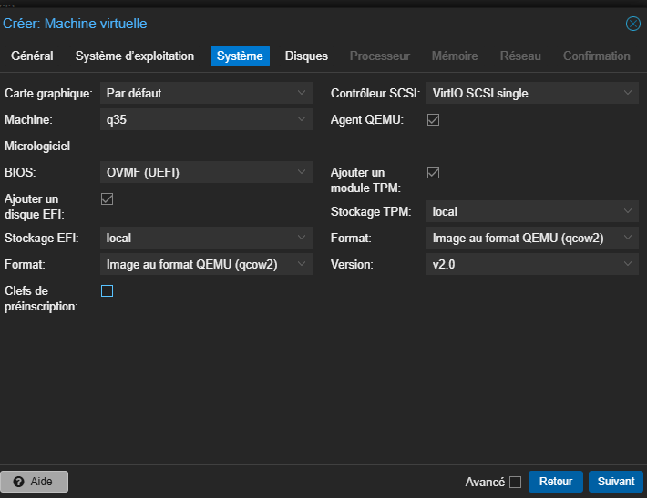

Il refuse aussi de s'installer sur moins de 64 Go. J'étais parti sur un disque de 32 Go et l'installeur s'est arrêté, donc je l'ai agrandi.

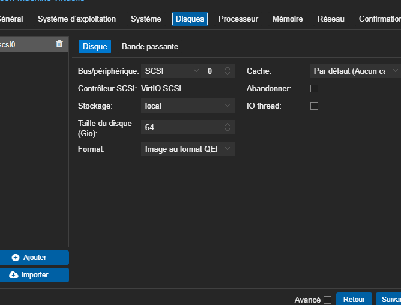

Pendant l'installation, la liste des disques était vide sur les deux machines, puisque Windows ne connaît pas le contrôleur VirtIO. J'avais monté l'ISO des pilotes virtio-win dans un second lecteur, ce qui m'a permis de charger `vioscsi` depuis cet écran, dans le dossier `2k25` pour le serveur et `w11` pour le client.

Le même problème se pose avec la carte réseau, si bien qu'à l'étape de configuration de Windows 11 le poste n'avait pas de réseau. Ça m'arrangeait, parce que Windows 11 connecté impose un compte Microsoft. J'ai ouvert une invite de commandes avec `Shift + F10` et lancé cette commande, qui ouvre directement la création d'un compte local :

```
start ms-cxh:localonly
```

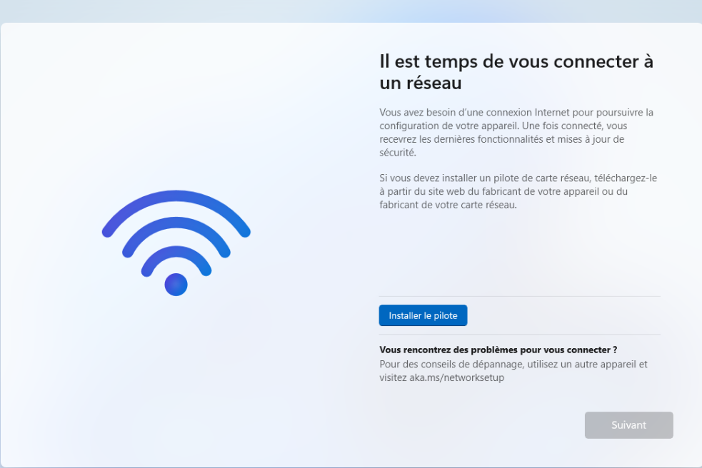

Une fois sur le bureau, j'ai installé `virtio-win-guest-tools.exe` depuis le CD sur les deux machines. Il apporte le pilote réseau qui manquait, le pilote de ballooning qui permet à Proxmox de récupérer la mémoire inutilisée, et l'agent QEMU, grâce auquel Proxmox affiche l'adresse IP de la VM et peut l'éteindre proprement.

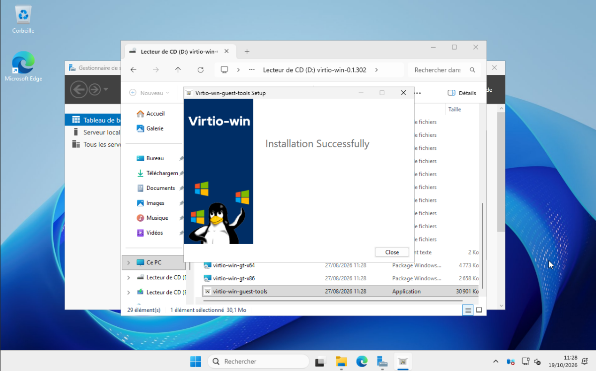

---

## Le contrôleur de domaine

Le serveur devait garder le même nom et la même adresse une fois promu, parce que la promotion les inscrit dans le DNS et dans l'annuaire et que les clients s'en servent ensuite pour trouver le contrôleur. Je l'ai donc renommé et je lui ai donné une IP fixe avant de le promouvoir.

Dans les propriétés IPv4, j'ai d'abord mis `10.0.0.1` dans le champ de l'adresse IP et laissé la passerelle vide.

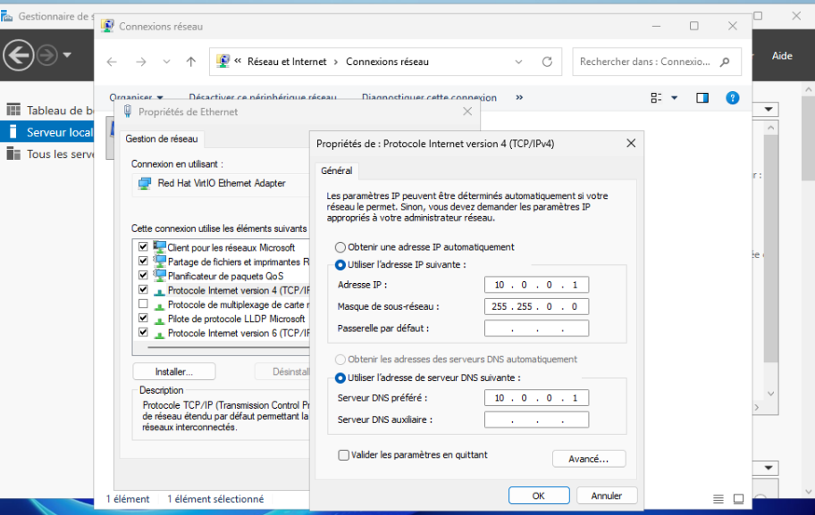

Le problème, c'est que `10.0.0.1` est l'adresse de l'OPNsense. `ipconfig /all` affichait cette adresse avec la mention « en double », accompagnée d'une seconde adresse en `169.254.160.9`, et le ping vers Internet échouait avec une défaillance générale.

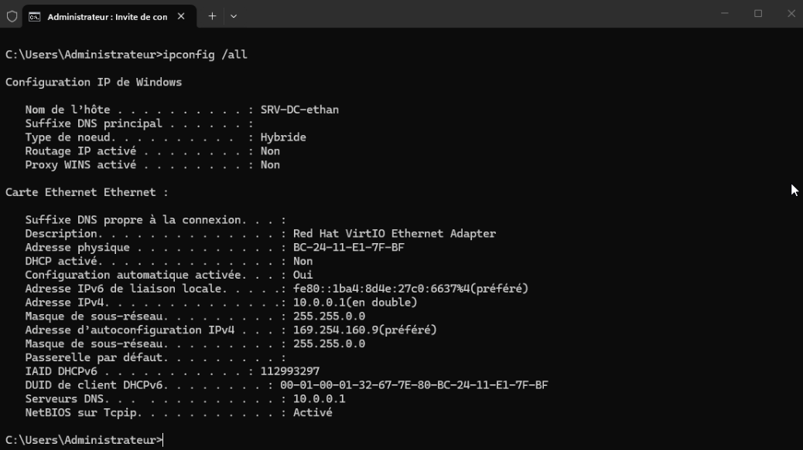

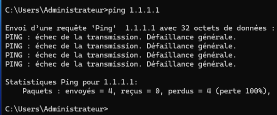

Avant d'utiliser une adresse, Windows demande sur le réseau si une autre machine l'occupe déjà. L'OPNsense a répondu, alors Windows a refusé l'adresse et s'est attribué une adresse APIPA en `169.254`, qui ne permet de parler qu'aux machines du même lien et pas de sortir du réseau. J'avais tout simplement mis l'adresse de la passerelle à la place de celle du serveur.

```
Adresse IP : 10.0.0.10
Masque     : 255.255.0.0
Passerelle : 10.0.0.1
DNS        : 10.0.0.1
```

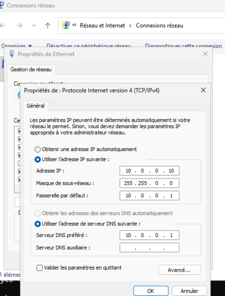

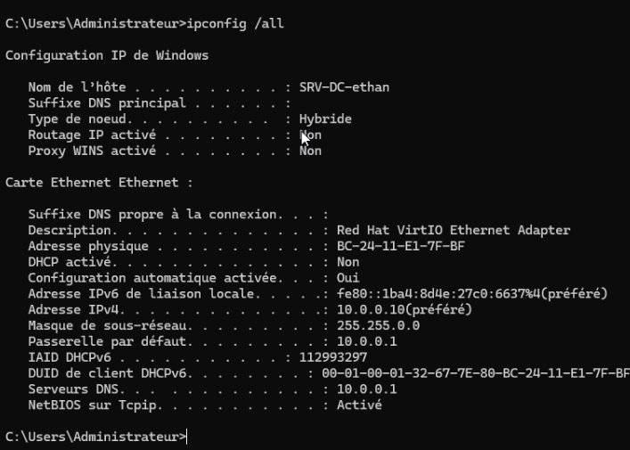

J'ai pris un snapshot de la VM à ce moment-là, puisque si la promotion échouait, revenir à ce point serait bien plus simple que de rétrograder un contrôleur de domaine.

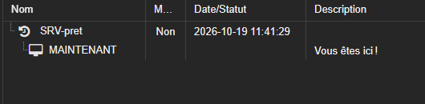

La promotion passe par l'installation du rôle AD DS, puis par la création d'une nouvelle forêt `oclock.lan`.

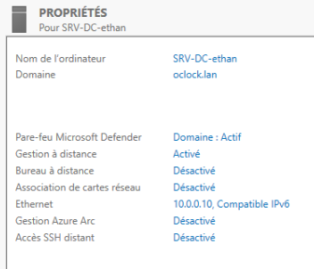

Après le redémarrage, la carte réseau du serveur pointe vers lui-même pour le DNS (`::1` et `127.0.0.1`), puisqu'il fait maintenant autorité sur `oclock.lan`. L'ancien DNS, `10.0.0.1`, a été déplacé tout seul dans les redirecteurs, et j'y ai ajouté `1.1.1.1`. Le serveur répond donc lui-même pour les noms du domaine et transmet les autres requêtes, ce que confirme un `nslookup google.com` qui passe par `localhost`.

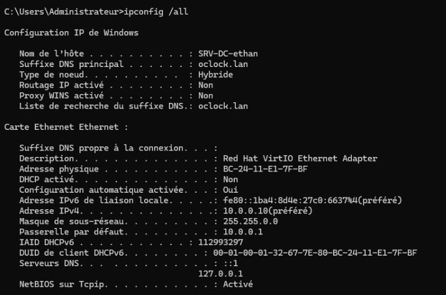

Côté poste client, l'adresse reste distribuée par le DHCP de l'OPNsense, mais celui-ci annonce aussi `10.0.0.1` comme serveur DNS, et l'OPNsense ne connaît pas `oclock.lan`. Le client n'aurait jamais trouvé le contrôleur de domaine, alors j'ai mis le DNS à la main sur `10.0.0.10`.

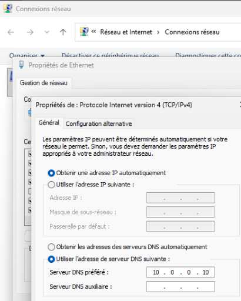

`nslookup oclock.lan` renvoie bien `10.0.0.10`. Le « Serveur : UnKnown » vient de l'absence de zone de recherche inversée, ce qui n'empêche rien de fonctionner.

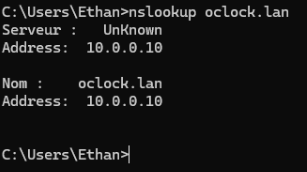

J'ai ensuite renommé le poste et je l'ai joint au domaine depuis la même fenêtre, et après le redémarrage il apparaît dans le conteneur Computers de l'annuaire.

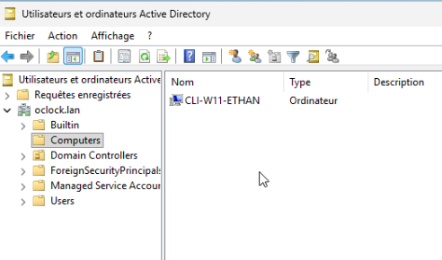

---

## Les comptes et les groupes

Toute la structure est rangée sous une unité d'organisation `Promotions`, avec une sous-unité par promotion qui contient l'étudiant et le groupe de sa promotion. Timothée et le groupe `GS_Promotions` se trouvent directement dans `Promotions`.

```
oclock.lan
└── Promotions
    ├── Timothée                       GS_Promotions
    ├── Volva      Bruce Lee           GS_PromoVolva
    ├── Heimdall   Marvyn Tachtache    GS_PromoHeimdall
    ├── Zinc       Robin Desbois       GS_PromoZinc
    ├── Licorne    Jean Dupont         GS_PromoLicorne
    └── Basilic    Alice Martin        GS_PromoBasilic
```

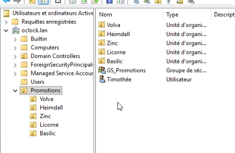

Les noms de groupes en `GS_` étaient imposés. Je les ai créés en groupes globaux de sécurité, parce qu'ils rassemblent des personnes selon leur promotion, ce qui correspond au premier niveau du modèle AGDLP : les comptes vont dans des groupes globaux, les groupes globaux dans des groupes domaine local, et c'est seulement sur ces derniers que l'on pose les permissions.

Rien n'indiquait qui devait faire partie de `GS_Promotions`. J'en ai fait le groupe de Timothée, sur le modèle des unités de promotion où chaque utilisateur a son groupe à côté de lui, et ça me donnait un moyen de lui ouvrir tous les dossiers sans jamais écrire son nom dans une permission.

---

## Les dossiers partagés

Je n'ai pas voulu mettre les dossiers sur `C:`. Sur un contrôleur de domaine, ce disque contient la base de l'annuaire et SYSVOL, et s'il se remplit c'est tout le domaine qui en souffre, pas seulement les partages. J'ai ajouté un second disque à la VM dans Proxmox, puis dans la gestion des disques je l'ai mis en ligne, initialisé en GPT et formaté en NTFS sous la lettre `F:`.

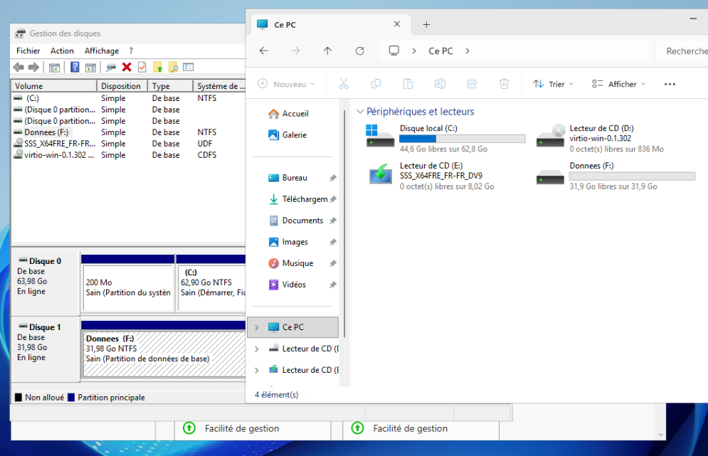

Chaque promotion a son dossier dans `F:\Shares`, partagé sous un nom caché qui se termine par `$`. Côté partage, tout le monde a le contrôle total, et c'est le NTFS qui fait le tri. Pour suivre AGDLP, j'ai créé un groupe domaine local par dossier dans une unité `Ressources`, et j'y ai placé le groupe de la promotion ainsi que `GS_Promotions`.

| Groupe domaine local | Membres |
|---|---|
| GL_Commun_PromoVolva_RW | GS_PromoVolva, GS_Promotions |
| GL_Commun_PromoHeimdall_RW | GS_PromoHeimdall, GS_Promotions |
| GL_Commun_PromoZinc_RW | GS_PromoZinc, GS_Promotions |
| GL_Commun_PromoLicorne_RW | GS_PromoLicorne, GS_Promotions |
| GL_Commun_PromoBasilic_RW | GS_PromoBasilic, GS_Promotions |

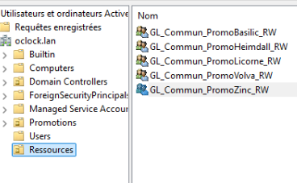

Sur chaque dossier, j'ai désactivé l'héritage en convertissant les autorisations héritées, retiré le groupe Utilisateurs qui donnait la lecture à tout le domaine, puis ajouté le groupe domaine local de la promotion en Modification. Administrateurs, Système et CREATEUR PROPRIETAIRE restent en place.

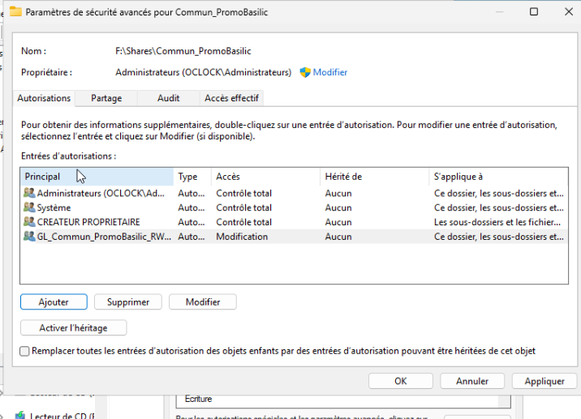

Les quotas et le filtrage passent par le Gestionnaire de ressources du serveur de fichiers. Le modèle de quota fixe une limite stricte de 30 Go, avec un avertissement dans le journal des événements à 80 % et à 100 %. Je l'ai appliqué comme quota automatique sur `F:\Shares`, ce qui crée un quota distinct sur chaque sous-dossier, donc 30 Go par promotion plutôt que 30 Go pour l'ensemble. Le disque ne fait que 32 Go alors que les quotas additionnés montent à 150 Go, mais un quota est un plafond et ne réserve aucun espace.

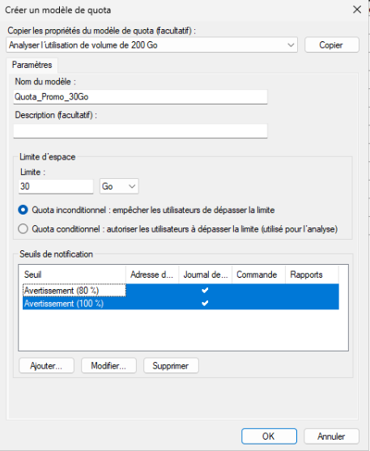

Seuls les `.divx` devaient être bloqués. Le groupe de fichiers audio et vidéo fourni avec l'outil couvre aussi les mp4, les mp3 et une bonne partie des formats courants, donc j'ai créé un groupe qui ne contient que `*.divx`, et un modèle de filtrage actif qui le bloque, appliqué sur `F:\Shares`.


---

## Les lecteurs réseau

Les lecteurs sont créés par une GPO liée à `Promotions`, avec une préférence de mappage par dossier.

| Lecteur | Chemin |
|---|---|
| V: | `\\SRV-DC-ethan\Commun_PromoVolva$` |
| H: | `\\SRV-DC-ethan\Commun_PromoHeimdall$` |
| Z: | `\\SRV-DC-ethan\Commun_PromoZinc$` |
| L: | `\\SRV-DC-ethan\Commun_PromoLicorne$` |
| K: | `\\SRV-DC-ethan\Commun_PromoBasilic$` |

Chaque lecteur est ciblé sur le groupe de sa promotion ou sur `GS_Promotions`. Quand on ajoute deux conditions de ciblage, Windows les combine par défaut avec un ET, et comme personne n'est à la fois étudiant et membre du groupe de Timothée, aucun lecteur ne serait apparu, d'où la seconde condition passée en OU. J'ai aussi donné une lettre différente à chaque promotion, puisque Timothée reçoit les cinq lecteurs et que deux lecteurs ne peuvent pas porter la même lettre.

Au premier essai avec le compte de Bruce Lee, l'étudiant de Volva, j'ouvrais bien son dossier en tapant le chemin à la main et celui de Heimdall m'était refusé, donc les permissions fonctionnaient, mais aucun lecteur n'apparaissait. `gpresult /r` montrait que la GPO de mappage était appliquée et que le compte avait bien ses groupes.

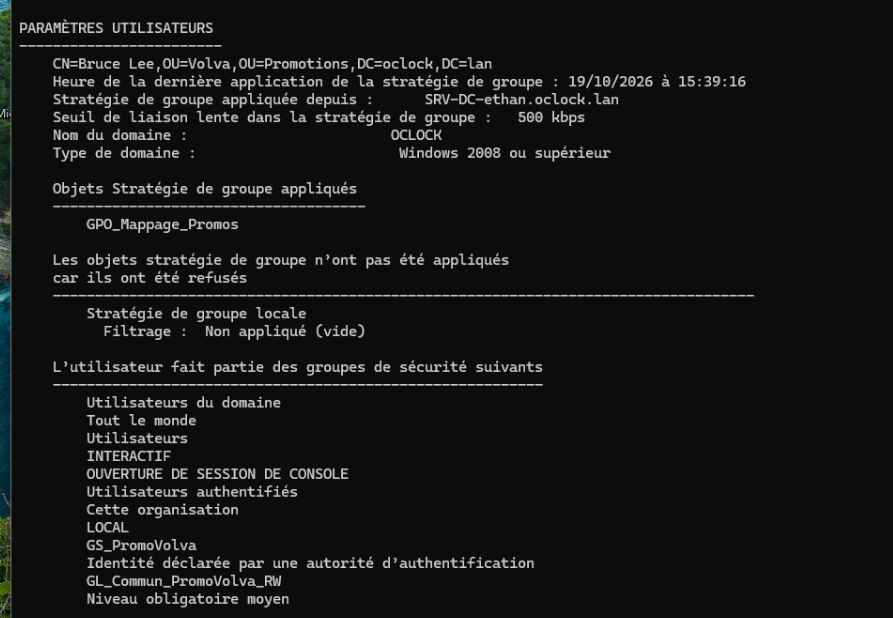

Le rapport complet donne le détail de chaque préférence :

```
gpresult /h rapport.html
```

Le lecteur V: y figure en échec avec le code `0x80070043`, qui correspond à un nom de réseau introuvable, et le chemin enregistré était `\\SRV-DC-ethan\Commun_PromoVolta$`, avec Volta au lieu de Volva.

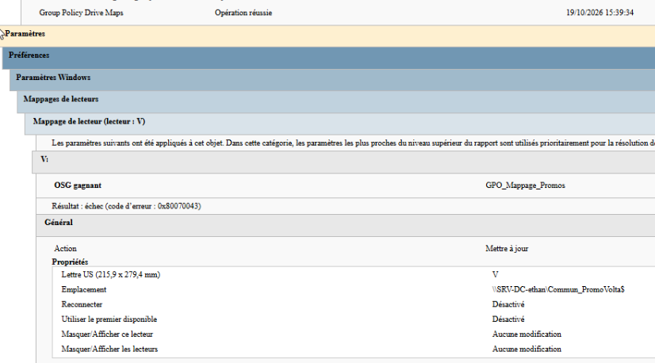

Une fois le nom corrigé, Bruce Lee ne voit que V:, peut y créer des fichiers et n'ouvre aucun autre dossier, tandis que Timothée voit les cinq lecteurs. Un fichier renommé en `test.divx` est refusé avec un message d'autorisation, le filtre se présentant côté client comme un simple refus d'accès.

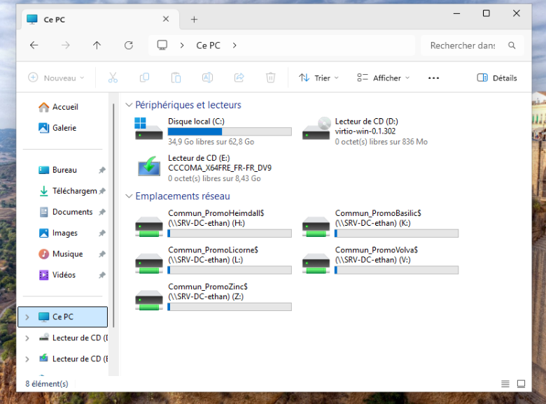

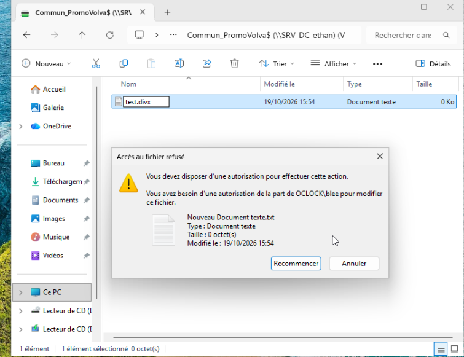

---

## Les règles pour les étudiants

Il n'existe pas de paramètre de stratégie pour le verrou numérique, mais Windows lit son état au démarrage dans la valeur `InitialKeyboardIndicators` de `Control Panel\Keyboard`, où `2` correspond au verrou numérique allumé. Je l'ai écrite avec une préférence de registre dans une GPO, une fois dans `HKEY_USERS\.DEFAULT` pour l'écran de connexion et une fois dans `HKEY_CURRENT_USER` pour la session. Cette GPO est liée à la racine du domaine, parce que le poste client est resté dans le conteneur Computers, qui n'est pas une unité d'organisation et sur lequel on ne peut pas lier de GPO. Liée à `Promotions`, sa partie ordinateur ne se serait jamais appliquée.

Pour le mot de passe, une GPO liée à l'unité des étudiants n'aurait rien changé, parce que la politique de mot de passe des comptes du domaine n'est lue qu'au niveau du domaine, et qu'une GPO liée à une unité d'organisation ne touche que les comptes locaux des machines qu'elle contient. Pour obtenir une règle propre aux étudiants, j'ai créé une stratégie de mot de passe affinée dans le Centre d'administration Active Directory, sous System puis Password Settings Container. Elle impose 12 caractères avec complexité, conserve un historique de 24 mots de passe et force un changement tous les 30 jours. Elle s'applique aux cinq groupes de promotion, ce qui laisse Timothée sur la politique du domaine.

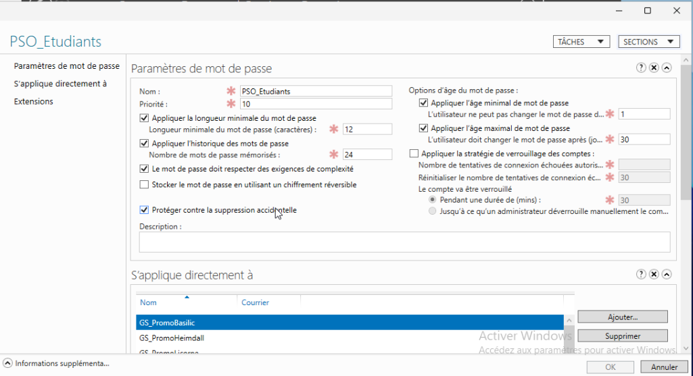

Pour le fond d'écran, j'ai utilisé une seule image pour toutes les promotions, partagée depuis `F:\Wallpaper`, et une GPO qui l'impose avec le paramètre Papier peint du Bureau. Elle est liée aux cinq unités de promotion et pas à `Promotions`, sans quoi Timothée l'aurait reçue aussi.

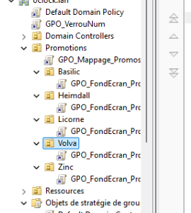

Au premier test, le fond restait noir alors que la GPO était bien appliquée, et le dossier partagé m'était refusé.

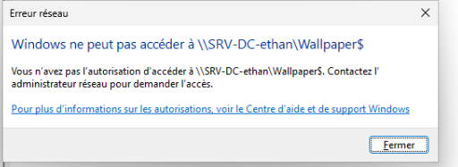

Dans le NTFS de ce dossier, j'avais donné la lecture à `GS_Promotions`, qui ne contient que Timothée, donc aucun étudiant ne pouvait lire l'image. Je l'ai remplacé par Utilisateurs authentifiés, une identité que Windows attribue d'office à tout compte connecté au domaine, et après une reconnexion le fond d'écran s'affiche.


Le `gpresult /r` du compte de Bruce Lee montre les trois GPO appliquées.

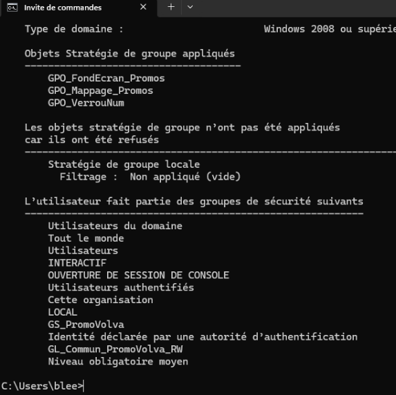

---

La structure AGDLP a tenu du début à la fin, et ce qui m'a bloqué venait toujours de ce que j'avais saisi dedans : l'adresse de la passerelle à la place de celle du serveur, une lettre de travers dans un chemin, et un groupe que j'avais mis dans une permission sans repenser à qui il contenait. À chaque fois, la réponse se trouvait dans un message ou un rapport que Windows fournissait déjà, que ce soit `ipconfig`, le rapport de `gpresult` ou le refus d'accès lui-même.
